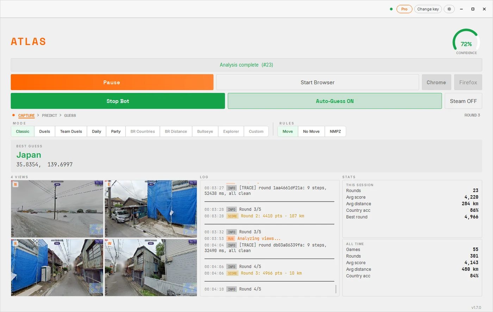
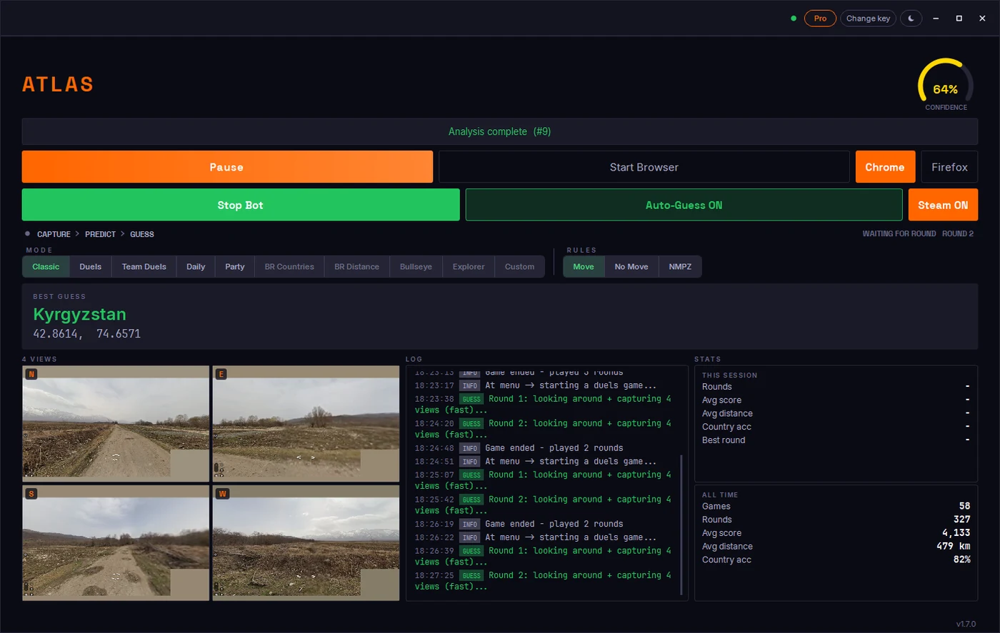

# The ATLAS GeoGuessr bot for Windows

Of everything ATLAS runs on, this is the only one you can walk away from.

The browser extension and the phone apps answer a round you are playing. The
Windows app plays the game. It opens a match, waits for the street view, works
out the location, drops the pin, submits, and takes the next round. Then it does
it again, for as long as you leave it running.

Download and pricing: **[geoguessrcheats.com/plans](https://geoguessrcheats.com/plans)**

---

## What unattended means here, precisely

People use the word loosely, so here is the literal list of what happens without
you touching anything:

- starting a match in the mode you picked
- waiting out loading, error pages and the occasional crash, then carrying on
- reading each round and deciding on a location
- moving the mouse across the map the way a person does, before it clicks
- placing the pin and pressing the guess button
- advancing to the next round, and after the last one, starting a new game
- writing the result into your history so you can look at it later

Since v1.5 it will not stall on a round it cannot read either. It guesses
regardless, because a guess that is 2,000 km out still scores and a blank round
scores nothing.

## Which games it can be pointed at

| | Supported |
|---|---|
| Classic single player | Yes |
| Duels | Yes |
| Team Duels | Yes |
| The Daily Challenge | Yes |
| Move | Yes |
| No Move | Yes |
| NMPZ | Yes |
| GeoGuessr on Steam | Yes, see [atlas-geoguessr-steam](https://github.com/Sven233333/atlas-geoguessr-steam) |

Movement rules do not change what it can do. A round where you are not allowed to
move is the round it was designed for anyway: it answers from the view in front of
it and never wanders off looking for a signpost.

## The weekly plan

The Bot Scheduler, added in v1.6, is a seven day grid. You fill in blocks: Duels
on Tuesday evening, NMPZ on Thursday, the Daily every morning. Save it once and
the week runs itself, in the modes you chose, at the times you chose.

## What you are looking at while it runs

A live view of the current round with the predicted country and coordinates,
session statistics that update as it plays, and a per game history you can go
back through afterwards. Twenty themes if you care what it looks like at two in
the morning.

## What you need

- Windows 10 or 11, 64 bit.
- A dedicated graphics card helps but is not required. Integrated graphics is
  fine. Since v1.5 the heavy part of the work happens on our side, which is also
  why a slow connection no longer breaks it.
- Around 4 GB of disk for the download. It used to be 7.5 GB.
- A licence key. The same one works in the browser extension and on your phone.

Updates install themselves and every one is signature checked before it is
allowed to replace anything.

## Getting started

1. Buy a key at [geoguessrcheats.com/plans](https://geoguessrcheats.com/plans).
2. Download the app from the link in your dashboard.
3. Paste the key once.
4. Pick a mode, press start, and leave it alone.

## The rest of the family

This repository is about the Windows app on its own. The overview of everything,
including which features exist where, is in
[Atlas-geoguessr-bot](https://github.com/Sven233333/Atlas-geoguessr-bot). The
browser and phone versions have their own pages:
[Chrome](https://github.com/Sven233333/atlas-geoguessr-chrome-extension),
[Firefox](https://github.com/Sven233333/atlas-geoguessr-firefox-addon),
[macOS](https://github.com/Sven233333/atlas-geoguessr-macos),
[iPhone](https://github.com/Sven233333/atlas-geoguessr-ios),
[Android](https://github.com/Sven233333/atlas-geoguessr-android).

## Common questions

**Can I use my computer while it plays?**
It drives the game window, so treat it as busy. Multi monitor support exists
precisely so it can have one screen while you use the other.

**Does it need me to stay logged in and watching?**
No. That is the entire point of this version.

**What happens if GeoGuessr throws an error page?**
It recovers and continues. That behaviour was added in v1.1 after overnight
sessions kept dying on them.

**Is there a trial for the desktop app?**
Not for this one. The free rounds live in the browser extension, which is the
cheapest way to see the predictions with your own eyes first.

**Will it run on a Mac under emulation?**
Not supported. See the [macOS
repository](https://github.com/Sven233333/atlas-geoguessr-macos) for what a Mac
can actually do.

## Disclaimer

ATLAS is an independent project with no affiliation to GeoGuessr AB. Automated
play may breach the rules of a game, a ladder or a competition. Read those rules
and make your own call about where you use this.
